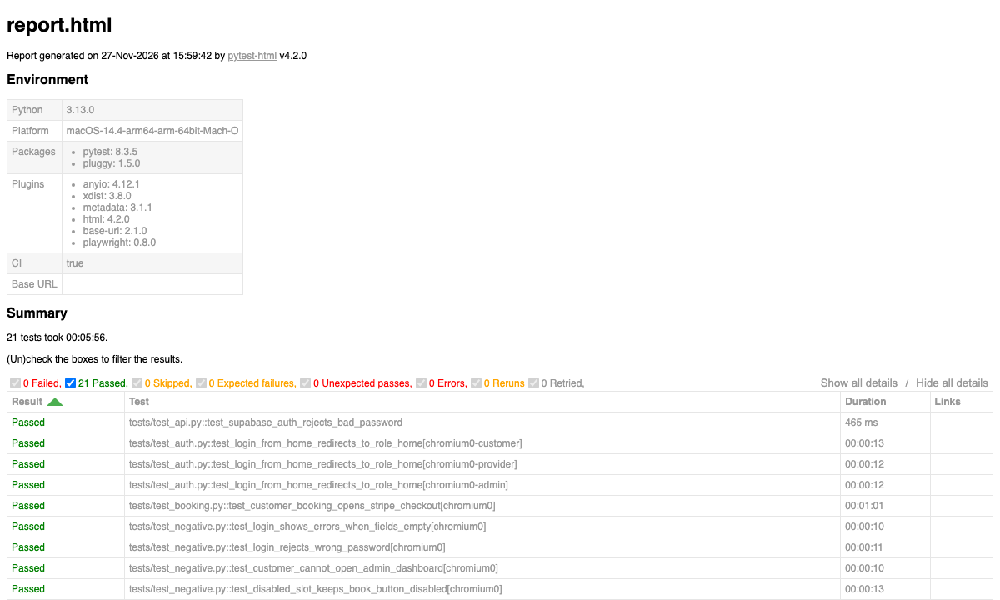

# BookNest Automation

End-to-end and API checks for [BookNest](https://booknest.niraj.shop) — customer / provider / admin booking flows.

[](https://github.com/uveshqualitylord-rgb/booknest-automation/actions/workflows/e2e.yml)

## Stack

- Python 3.13
- Pytest + Playwright (POM)
- pytest-html reports
- GitHub Actions on every push / PR

## Coverage

| Suite | What it checks |
|--------|----------------|
| Smoke | Home UI + HTTP 200 for `/` and `/service-discovery` |
| Auth | Customer / provider / admin login → role home |
| Booking (CI) | Discover → open slot → Stripe Checkout opens |
| Booking (local) | Card fill → Pay → Paid (`pytest -m stripe_fill`) |
| Negative | Empty login, wrong password, disabled slot, customer blocked from admin |
| Negative (local) | Declined card (`4000…0002`) via `stripe_fill` |
| API | Supabase auth rejects bad password |

## Layout

```text
booknest-automation/
├── pages/
├── tests/
├── data/users.py
├── config/settings.py
├── conftest.py
└── .github/workflows/e2e.yml
```

## Setup

```bash
python3 -m venv .venv
source .venv/bin/activate
pip install -r requirements.txt
playwright install chromium
cp .env.example .env
```

Fill `.env` with app credentials plus `SUPABASE_URL` and `SUPABASE_ANON_KEY` for the API test.

## Run

```bash
pytest -v -m "not stripe_fill"
pytest -m stripe_fill -v
pytest -m negative -v
pytest -m api -v
```

HTML report: `reports/report.html`  
On failure Playwright keeps screenshots and traces under `test-results/`.

## CI

Runs `pytest -m "not stripe_fill"` on `ubuntu-24.04`. Full card payment is local-only because hosted Checkout often shows Link/wallet UI in CI without `#payment-numberInput`.

Secrets: `BASE_URL`, role emails/passwords, `SUPABASE_URL`, `SUPABASE_ANON_KEY`.

Artifacts: pytest HTML report (always) and failure screenshots/traces.

## Sample report


